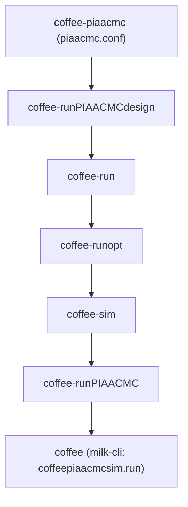

# Introduction {#page_PIAACMCsimul_Introduction}

## Scope

`PIAACMCsimul` performs end-to-end diffractive simulation, multi-stage optimization, and
polychromatic contrast evaluation of Phase-Induced Amplitude Apodization Complex Mask Coronagraphs
(**PIAACMC**) and Apodized Pupil Lyot Complex Mask Coronagraphs (**APLCMC**):

- Uses the multi-wavelength Fresnel propagation engine (`OptSystProp`) between optical elements.
- Synthesizes multiple Lyot stops across distinct axial conjugations to track chromatic and
  pupil-dependent diffraction.
- Fits aspheric PIAA mirror or lens surfaces onto 2D radial cosine (`Cmodes`) and 2D Fourier
  (`Fmodes`) modal bases.
- Calibrates polychromatic complex electric-field zone responses (`FPMresp`) across parallel
  worker processes and solves for optimal multi-zone focal plane mask sags via regularized SVD.

---

## Command-Line Architecture

Installed executables live in `<milk-install-prefix>/bin` (no workspace symlink scripts needed).
Design workflows are driven through `coffee-piaacmc` (recommended) or the underlying layered
scripts:

| Executable | Role |
|---|---|
| `coffee-piaacmc` | Unified driver (`init`, `config`, `run`, `eval`, `quantize`, `status`) |
| `coffee-runPIAACMCdesign` | Legacy flag-based entry point (`-e`, `-m`, `-q`, `-c`, `-C`) |
| `coffee-run` | Reads `conf/conf_*.txt` workspace parameters and invokes `coffee-runopt` |
| `coffee-runopt` | Manages single-point optimization, parameter sweeps, and evaluations |
| `coffee-sim` | Resolves pupil files and invokes `coffee-runPIAACMC` |
| `coffee-runPIAACMC` | Step state machine (`step000..step725`) driving `coffee` (`milk-cli`) |

